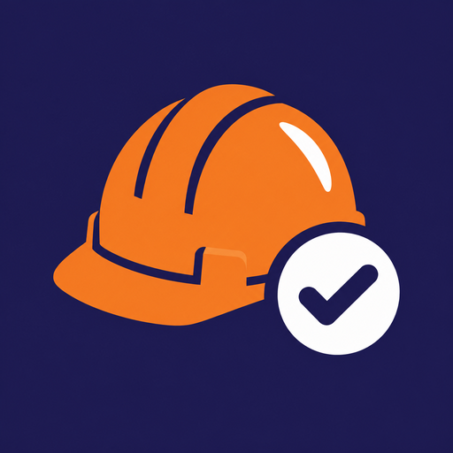
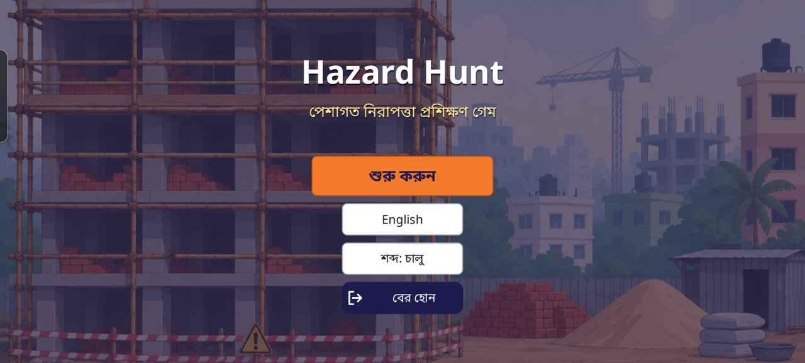
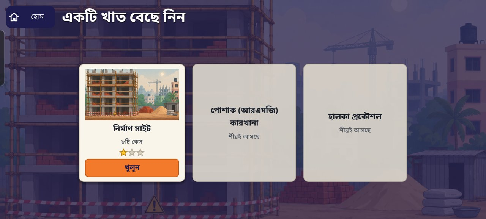
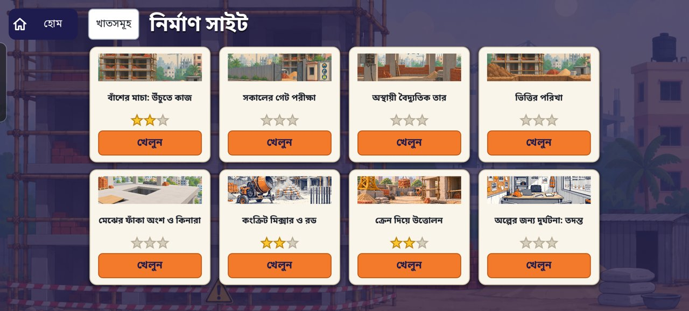
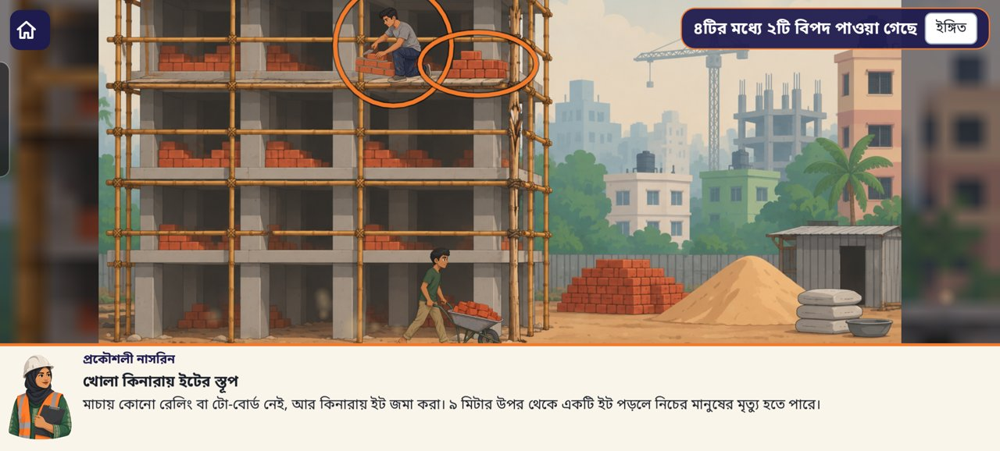
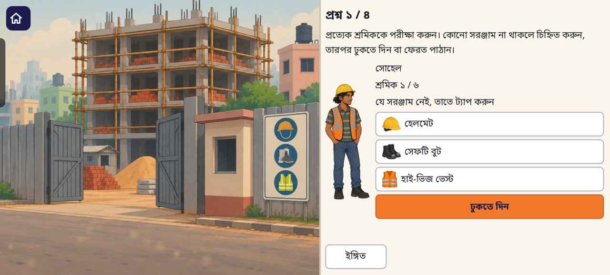
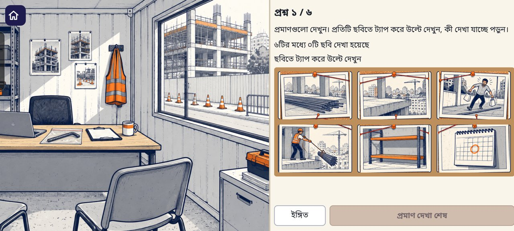
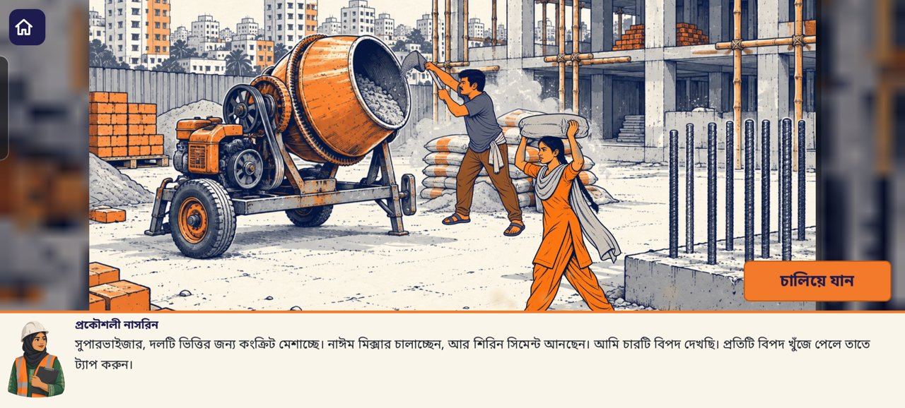
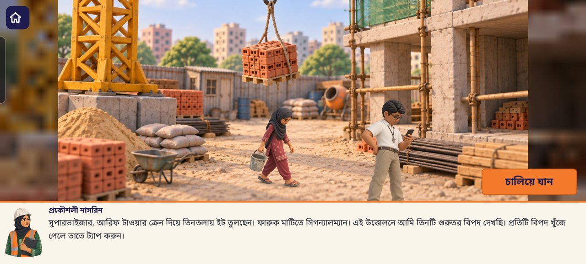

<p align="center">
  
</p>

<h1 align="center">Hazard Hunt</h1>
<p align="center"><b>OSH training game</b> · পেশাগত নিরাপত্তা প্রশিক্ষণ গেম</p>

<p align="center">
  <a href="https://github.com/shourovrm/hazard-hunt/releases/latest/download/hazard-hunt.apk"><b>⬇ Download the latest Android APK</b></a>
  ·
  <a href="https://github.com/shourovrm/hazard-hunt/releases/latest">Release notes</a>
</p>

Hazard Hunt is an Android game for skills trainees in Bangladesh that teaches occupational safety and health (OSH). The player is a site supervisor. Each case shows an unsafe workplace, the player finds the hazards and answers questions, and then sees the same place made safe. The game runs offline, in Bangla or English, on low-cost phones.

<p align="center">
  
  
  
  
  
  
  
  
</p>

## Cases

The construction sector has 8 cases. Garments (RMG) and light engineering are planned.

| # | Case | What the trainee practises |
|---|------|----------------------------|
| 1 | Bamboo scaffold: work at height | Finding hazards, hierarchy of controls, persuading a worker, PPE |
| 2 | Morning gate check | Checking each worker's helmet, boots and vest at the gate |
| 3 | Temporary electrical wiring | Lock-out tag-out, earth-leakage breakers, shock first aid |
| 4 | Foundation trench | Permit to work: mark each condition, then approve or refuse |
| 5 | Floor openings and edges | Covers, guardrails, safe carrying |
| 7 | Concrete mixer and rebar | Machine guards, loose clothing, cement dust, rebar caps |
| 8 | Crane lifting | Slings, tag lines, exclusion zones, the signaller's job |
| 12 | Near-miss investigation | Evidence board, open interview questions, 5 Whys, action plan |

Every question has a free **Hint**, and **Show answer** appears after a wrong try, so nobody gets stuck. Stars reward getting it right first time.

## Install

1. Download [`hazard-hunt.apk`](https://github.com/shourovrm/hazard-hunt/releases/latest/download/hazard-hunt.apk) on an Android phone (Android 7 or newer, OpenGL ES 3.0).
2. Open the file and allow installing from this source when Android asks.

## Build from source

Requirements: Godot 4.7.2 with the 4.7.2 Android export templates, the Android SDK, Java 21, and [gdtoolkit](https://github.com/Scony/godot-gdscript-toolkit) for formatting and linting.

```sh
godot --path .                                               # run on the desktop
godot --headless --path . --import                           # import assets once
godot --headless --path . res://tests/test_runner.tscn       # run all tests
gdformat --check --line-length=120 core ui game tests        # format check
gdlint core ui game tests                                    # lint
godot --headless --path . --export-debug "Android" build/hazard-hunt.apk
```

## Project layout

- `core/`: case loading and validation, scoring, saved progress, language, sound.
- `ui/questions/`: one view per question type.
- `game/`: menu, sector page, case map, case player and animations.
- `content/`: sectors and cases as JSON, every text in Bangla and English. A new case is a new JSON file plus its images; see `docs/CONTRACT.md`.
- `assets/`: game images, fonts and sounds. `art_source/` holds the original generated images.
- `tests/`: automated tests for every module and every case.

## Content status

The case texts and legal references are drafts. An OSH expert must review them before the game is used in training. A review copy of all Bangla texts is in `docs/review/`.

## Credits

- Developed for SICIP skills training.
- Illustrations generated with AI (OpenAI GPT Image) and edited for the game.
- Fonts: Noto Sans and Noto Sans Bengali, SIL Open Font License (`assets/fonts/OFL.txt`).
- Sound effects: Kenney (www.kenney.nl), CC0 (`assets/audio/CREDITS.txt`).

## License

Copyright © 2026 Riad Mashrub Shourov. All rights reserved; see `LICENSE`. The bundled fonts and sounds keep their own licences.
